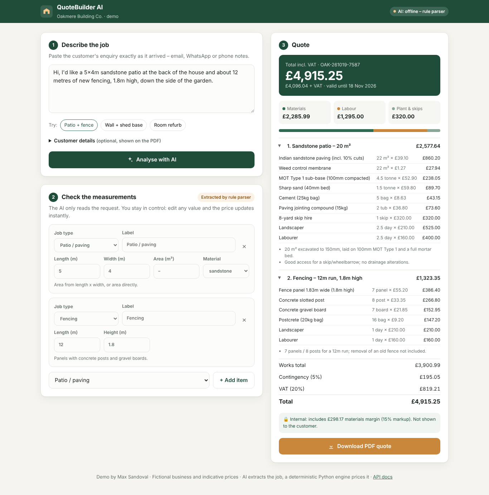

# QuoteBuilder AI

**Turn a customer's messy enquiry into an itemised, priced building quote and a branded PDF in about 10 seconds.**

> *"Hi, I'd like a 5x4m sandstone patio at the back and about 12 metres of new fencing, 1.8m high, down the side."*
> → 2 job items → 15 priced lines (materials, plant, labour) → **£4,915.25 inc. VAT** → PDF ready to send.

🔗 **Live demo:** _add your Render URL here_ · 🎬 **2-min video:** _add link_



---

## The problem

Small builders and landscapers lose evenings to quoting. Every enquiry means working out slabs, sub-base,
bricks, posts, skips and labour days by hand, then typing it all into Word. Slow quotes lose jobs, and
rushed quotes lose money.

## What it does

1. **Describe:** paste the enquiry exactly as it arrived (email, WhatsApp, phone notes).
2. **Extract (AI):** Google Gemini turns the text into structured job items (type, dimensions, materials)
   and lists any **questions to ask the customer** when information is missing.
3. **Review:** the estimator checks and edits every measurement. The price updates live.
4. **Price (deterministic):** a Python engine calculates quantities with waste factors and applies the
   business's own price book, labour day rates, markup, contingency and VAT.
5. **Send:** download a branded, customer-ready PDF quotation.

### Design principle: the AI reads, the code calculates

LLMs are good at understanding *"about 30ft of fence down the side"*. They should not be trusted to invent
prices. So the AI only produces structured data, validated with a strict JSON schema and Pydantic. **Every
pound in the quote comes from auditable rules and an editable price book** (`app/price_book.json`).
The owner can re-price everything without touching code.

The app **never stops working**: if there is no API key, or Gemini is down or rate-limited, it falls back
to a built-in rule-based parser (regex + keywords, which handles feet→metres, room sizes→wall area, decimals, etc.).

## Supported jobs

| Job | Inputs | What it calculates |
|---|---|---|
| Patio / paving | L×W or m², sandstone / porcelain / concrete | slabs +10% cuts, MOT Type 1, mortar bed, jointing, membrane, skip, digger, labour |
| Brick garden wall | length, height, single / double skin | bricks (60/m²/skin +5%), mortar, concrete footing, coping, mixer, labour |
| Fencing | length, height | panels, posts, gravel boards, postcrete, labour |
| Concrete base | L×W or m², depth | ready-mix, sub-base, DPM, A142 mesh, skip, labour |
| Plastering (skim) | m² or L×H | multi-finish bags, PVA, beads/sundries, plasterer days |
| Interior painting | m², L×H or room size, coats | emulsion tins by coverage, sundries, decorator days |
| Laminate flooring | L×W or m² | packs +10% waste, underlay, trims, fitter days |

Adding a new job type = one pricing function + one entry in `JOB_TYPES`.

## Tech stack

- **Backend:** Python 3.12, FastAPI, Pydantic v2
- **AI:** Google Gemini (`gemini-2.5-flash`, free tier) with structured JSON output (`responseSchema`)
- **PDF:** ReportLab
- **Frontend:** plain HTML/CSS/JavaScript with no build step, responsive down to mobile
- **Quality:** 22 pytest tests (pricing maths, parser, AI path mocked, API, PDF), GitHub Actions CI
- **Deploy:** Render (`render.yaml`) or any Docker host (`Dockerfile`)

```
app/
├── main.py          # FastAPI routes (/api/extract, /api/quote, /api/quote/pdf)
├── extraction.py    # Gemini extraction + rule-based fallback
├── pricing.py       # deterministic pricing engine
├── price_book.json  # editable prices, day rates, markup, VAT
├── pdf.py           # branded PDF quotation
├── models.py        # Pydantic schemas
└── static/          # single-page UI
tests/               # pytest suite
```

## Run locally

```bash
git clone https://github.com/<your-user>/quotebuilder-ai.git
cd quotebuilder-ai
python -m venv .venv && source .venv/bin/activate   # Windows: .venv\Scripts\activate
pip install -r requirements-dev.txt

# optional: enable AI (free key from https://aistudio.google.com/apikey)
export GEMINI_API_KEY=your-key                      # Windows: set GEMINI_API_KEY=your-key

uvicorn app.main:app --reload
# open http://localhost:8000  ·  API docs at http://localhost:8000/docs
pytest -q
```

## Deploy (free) on Render

1. Push this repo to GitHub.
2. On [render.com](https://render.com), choose **New → Blueprint** and select the repo (it reads `render.yaml`).
3. Add the `GEMINI_API_KEY` environment variable and deploy.

*Free instances sleep when idle, so the first request can take ~30-50 s.*

## API

```bash
curl -X POST localhost:8000/api/extract -H "Content-Type: application/json" \
  -d '{"description": "a 30ft fence and a 25 sqm porcelain patio"}'
```

`POST /api/quote` takes the (edited) items and returns the full priced quote as JSON. `POST /api/quote/pdf`
returns the PDF. Interactive docs are at `/docs`.

## What I'd build next for a real client

- Load the client's real supplier prices (CSV/Google Sheet sync) and their past quotes to calibrate labour rates
- Photo upload: the customer snaps the garden, and a vision model estimates areas for the estimator to confirm
- Email/WhatsApp intake, so quotes are drafted automatically as enquiries arrive
- Accept-quote link with deposit payment, plus a pipeline/CRM view of sent, accepted and won quotes
- Xero / QuickBooks export to convert an accepted quote into an invoice

---

*Oakmere Building Co. is a fictional business. Prices are indicative UK trade prices for demonstration only.*
Built by **Max Sandoval**, MSc Financial Technology student at the University of Essex.
